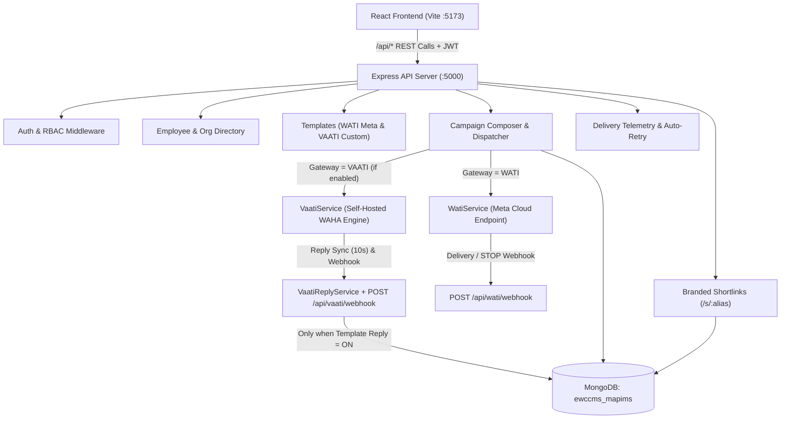
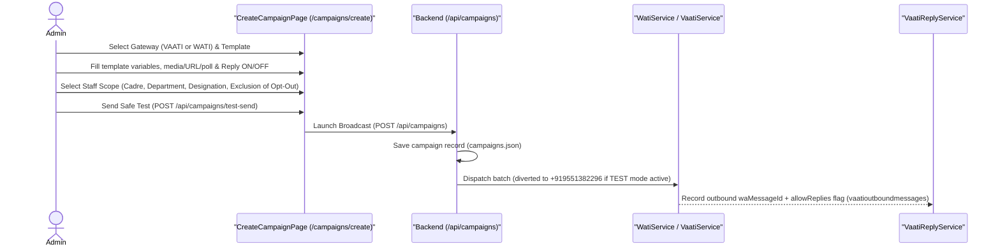
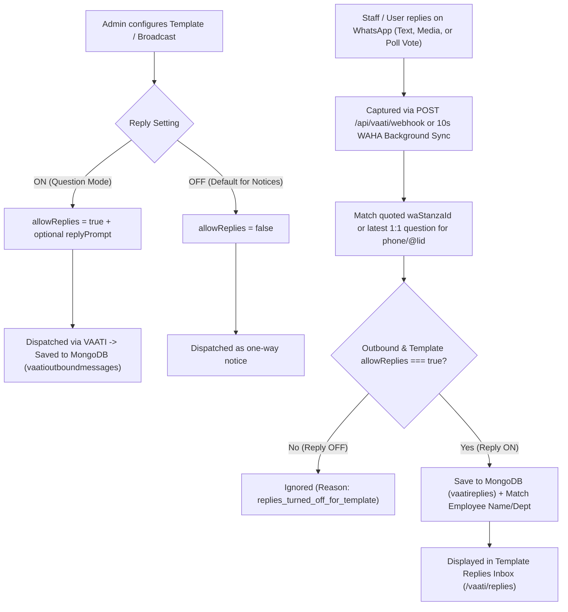

# APH Connect (MAPIMS Hospitals) — Complete Application Flow

**Platform:** Employee WhatsApp Communication & Broadcast Platform  
**Stack:** React + Vite + Tailwind CSS (`frontend/`) · Node.js + Express + TypeScript (`backend/`) · MongoDB (`ewccms_mapims`) + JSON Data Stores  
**Gateways:** Dual-gateway architecture supporting **WATI** (Meta Cloud API) and **VAATI** (Self-Hosted WAHA WhatsApp Web Engine)

---

## 1. High-Level System Architecture



---

## 2. Authentication, RBAC & Safety Sandbox Flow

1. **Login (`/login` -> `POST /api/auth/login`)**:
   - Issues a signed JWT (`JWT_EXPIRES_IN=8h`) with user identity and role.
   - Supported roles in [User.ts](file:///mnt/84F0DAA2F0DA9A2E/WP%20communication/backend/src/models/User.ts): `Super Admin`, `HR`, `MS`, `MD`.
2. **Route & API Protection**:
   - Frontend: `ProtectedRoute` and `RoleRoute` in [App.tsx](file:///mnt/84F0DAA2F0DA9A2E/WP%20communication/frontend/src/App.tsx) restrict admin-only screens (`/admin/*`) strictly to `Super Admin`.
   - Backend: `authenticate` and `requireRole(...)` in [auth.ts](file:///mnt/84F0DAA2F0DA9A2E/WP%20communication/backend/src/middleware/auth.ts) enforce permissions per endpoint (with `Super Admin` override).
3. **Working Mode Safeguard (`TEST` vs `LIVE`)**:
   - Exposed via `GET /api/system/mode` and `POST /api/system/mode` ([apiController.ts](file:///mnt/84F0DAA2F0DA9A2E/WP%20communication/backend/src/controllers/apiController.ts)).
   - When `IS_TEST_MODE` is active (`TEST` mode), all campaign broadcasts and test sends are intercepted and diverted to the authorized test handset (`+91 95513 82296`) so real hospital staff are never messaged accidentally during testing.

---

## 3. Employee & Organization Directory Flow

- **Pages**:
  - [EmployeeListPage.tsx](file:///mnt/84F0DAA2F0DA9A2E/WP%20communication/frontend/src/pages/employees/EmployeeListPage.tsx) (`/employees`)
  - [EmployeeCategoriesPage.tsx](file:///mnt/84F0DAA2F0DA9A2E/WP%20communication/frontend/src/pages/employees/EmployeeCategoriesPage.tsx) (`/employees/designations`)
  - [DepartmentManagementPage.tsx](file:///mnt/84F0DAA2F0DA9A2E/WP%20communication/frontend/src/pages/employees/DepartmentManagementPage.tsx) (`/employees/departments`)
  - [ConsentOptOutPage.tsx](file:///mnt/84F0DAA2F0DA9A2E/WP%20communication/frontend/src/pages/admin/ConsentOptOutPage.tsx) (`/admin/consent`)
- **Backend Endpoints**:
  - `GET /api/employees`, `POST /api/employees`, `POST /api/employees/bulk`, `PATCH /api/employees/phone`, `GET /api/designations`, `POST /api/designations`.
- **Consent & Number Normalization**:
  - Phone inputs are normalized (`+91` E.164 / 10-digit handling via `normalizePhoneNumber` & `toWatiDigits`).
  - Employees have a `consentStatus` (`Opted-In`, `Opted-Out`, `Pending Verification`, `Unknown`).
  - Staff marked `Opted-Out` (either manually or via WATI `STOP` webhook) are automatically excluded from campaign recipient lists.

---

## 4. Dual WhatsApp Gateway Flow (WATI vs VAATI)

The platform lets admins switch or turn VAATI ON/OFF independently at any time:
- **Status & Power Toggle**:
  - `GET /api/gateway/status` returns status for both **WATI** (Meta endpoint) and **VAATI** (WAHA session `tenant_efs`, live connection state, linked phone number, pushName).
  - `POST /api/gateway/toggle` enables or disables VAATI (`VaatiService.setEnabled(boolean)`). When turned OFF, VAATI dispatches are blocked and campaigns default back to WATI.
- **Gateway Health Screen**:
  - [VaatiGatewayPage.tsx](file:///mnt/84F0DAA2F0DA9A2E/WP%20communication/frontend/src/pages/vaati/VaatiGatewayPage.tsx) (`/vaati/gateway`) monitors the self-hosted WAHA node (`VAATI_API_ENDPOINT`, session `tenant_efs`) and gateway toggle.

---

## 5. Template Flows

### A. WATI Templates (Meta Cloud)
- **Pages**: [TemplateLibraryPage.tsx](file:///mnt/84F0DAA2F0DA9A2E/WP%20communication/frontend/src/pages/templates/TemplateLibraryPage.tsx) (`/templates`), [TemplateDesignerPage.tsx](file:///mnt/84F0DAA2F0DA9A2E/WP%20communication/frontend/src/pages/templates/TemplateDesignerPage.tsx) (`/templates/designer`), [MediaLibraryPage.tsx](file:///mnt/84F0DAA2F0DA9A2E/WP%20communication/frontend/src/pages/templates/MediaLibraryPage.tsx) (`/templates/media`).
- **API**: `GET /api/templates`, `POST /api/templates`, `POST /api/templates/sync`, `DELETE /api/templates/:id`, `POST /api/templates/:id/restore`.
- **Behavior**: Syncs live Meta-approved templates (filtered to APH Connect `aph_*` / `aphconnect_*` templates) and supports soft-delete to Trash (`trashed_templates.json`) and restore while preserving historical reports.

### B. VAATI Custom Templates Studio (Self-Hosted, No Meta Approval)
- **Pages**:
  - [VaatiTemplatesPage.tsx](file:///mnt/84F0DAA2F0DA9A2E/WP%20communication/frontend/src/pages/vaati/VaatiTemplatesPage.tsx) (`/vaati/templates`)
  - [CreateVaatiTemplatePage.tsx](file:///mnt/84F0DAA2F0DA9A2E/WP%20communication/frontend/src/pages/vaati/CreateVaatiTemplatePage.tsx) (`/vaati/templates/create`)
- **API**: `GET /api/vaati/templates`, `POST /api/vaati/templates`, `PUT /api/vaati/templates/:id`, `PATCH /api/vaati/templates/:id/reply-toggle`, `DELETE /api/vaati/templates/:id`, `POST /api/vaati/templates/test-send`.
- **5 Supported Payload Formats**:
  1. `text` -> `POST /api/sendText`
  2. `url_text` -> `POST /api/sendText` with `linkPreview: true` and CTA URL
  3. `image_text` -> `POST /api/sendFile` (image URL or uploaded base64 + caption)
  4. `pdf_text` -> `POST /api/sendFile` (PDF URL or uploaded base64 + caption)
  5. `poll` -> `POST /api/sendPoll` (1-Tap Yes/No or multi-choice buttons)
- **Formatting & Footer**:
  - Includes a WhatsApp font toolbar (`*bold*`, `_italic_`, `~strike~`, ````mono````, `` `code` ``, lists, quote) with live smartphone preview.
  - Footers are styled in italic in the UI and automatically formatted with WhatsApp `_italic_` markers line-by-line via `VaatiService.formatItalicFooter(...)` on outgoing messages.

---

## 6. Campaign Creation & Broadcast Dispatch Flow



- **Pages**: [CreateCampaignPage.tsx](file:///mnt/84F0DAA2F0DA9A2E/WP%20communication/frontend/src/pages/campaigns/CreateCampaignPage.tsx) (`/campaigns/create`), [CampaignHistoryPage.tsx](file:///mnt/84F0DAA2F0DA9A2E/WP%20communication/frontend/src/pages/campaigns/CampaignHistoryPage.tsx) (`/campaigns/history`).
- **Backend Endpoints**: `GET /api/campaigns`, `POST /api/campaigns`, `POST /api/campaigns/test-send`, `POST /api/campaigns/:id/approve`, `POST /api/campaigns/:id/reject`, `POST /api/campaigns/:id/dispatch`.

---

## 7. Template Question Replies Flow (Reply ON / OFF -> MongoDB)



- **Key Files**: [VaatiReply.ts](file:///mnt/84F0DAA2F0DA9A2E/WP%20communication/backend/src/models/VaatiReply.ts), [vaatiReplyService.ts](file:///mnt/84F0DAA2F0DA9A2E/WP%20communication/backend/src/services/vaatiReplyService.ts), [vaatiReplyController.ts](file:///mnt/84F0DAA2F0DA9A2E/WP%20communication/backend/src/controllers/vaatiReplyController.ts), [VaatiRepliesPage.tsx](file:///mnt/84F0DAA2F0DA9A2E/WP%20communication/frontend/src/pages/vaati/VaatiRepliesPage.tsx).
- **Capabilities**:
  - Toggle `Reply ON / OFF` inside template builder, directly on any card in VAATI Templates, or inside Campaign creation.
  - Resolves WhatsApp `@lid` IDs to real phone numbers via WAHA `/api/{session}/lids/{lid}` and links each reply to the matching hospital employee.
  - Admins can sync replies immediately, filter by template or status (`NEW` / `REVIEWED`), add admin notes, or delete records.

---

## 8. Delivery Reports, Webhooks & Auto-Retry Flow

- **Delivery Telemetry**:
  - **Page**: [DeliveryReportsPage.tsx](file:///mnt/84F0DAA2F0DA9A2E/WP%20communication/frontend/src/pages/reports/DeliveryReportsPage.tsx) (`/reports/delivery`)
  - **API**: `GET /api/reports/delivery`, `POST /api/reports/retry`
- **WATI Webhook (`POST /api/wati/webhook`)**:
  - Processes delivery/read callbacks and `STOP` opt-out keywords, automatically updating the matching employee's `consentStatus` to `Opted-Out`.
- **Automated Retry Policy ([retryService.ts](file:///mnt/84F0DAA2F0DA9A2E/WP%20communication/backend/src/services/retryService.ts))**:
  - Runs a background worker every 30 seconds to retry failed WATI deliveries automatically (Stage 1 at 30 minutes, Stage 2 at 60 minutes, up to exhaustion), plus manual admin retry.

---

## 9. Branded Shortlinks & Analytics Flow

- **Pages** (`Super Admin` only): [ShortlinksPage.tsx](file:///mnt/84F0DAA2F0DA9A2E/WP%20communication/frontend/src/pages/admin/ShortlinksPage.tsx) (`/admin/shortlinks`), [ShortlinkAnalyticsPage.tsx](file:///mnt/84F0DAA2F0DA9A2E/WP%20communication/frontend/src/pages/admin/ShortlinkAnalyticsPage.tsx) (`/admin/shortlinks/:id/analytics`).
- **Public Redirect Endpoints**: `GET /s/:alias` and `GET /shortlinks/:alias` (mounted in [server.ts](file:///mnt/84F0DAA2F0DA9A2E/WP%20communication/backend/src/server.ts)).
- **Management Endpoints**: `GET /api/shortlinks`, `POST /api/shortlinks`, `GET /api/shortlinks/:id`, `PUT /api/shortlinks/:id`, `PATCH /api/shortlinks/:id/toggle`, `GET /api/shortlinks/:id/analytics`.
- **Tracking**: Logs click timestamps (UTC + IST), distinguishes WhatsApp preview bots/crawlers from human opens, records device/browser/OS, and stores data in MongoDB (`shortlinks` collection via [Shortlink.ts](file:///mnt/84F0DAA2F0DA9A2E/WP%20communication/backend/src/models/Shortlink.ts)) + JSON mirror (`shortlinks.json`).

---

## 10. Storage & Code Structure Summary

- **MongoDB (`MONGO_URI=mongodb://localhost:27017/ewccms_mapims`)**:
  - `vaatioutboundmessages` — Dispatched VAATI template questions & `allowReplies` state
  - `vaatireplies` — Captured staff/user answers (text, media, poll votes, review status, admin notes)
  - `shortlinks` — Short URLs and click analytics events
  - Mongoose models defined for `campaigns`, `deliverylogs`, `auditlogs`, `employees`, `templates`, `categories`, `departments`, `users`
- **Local JSON Data Store Mirrors (`backend/src/data/`)**:
  - `employees.json`, `designations.json`, `campaigns.json`, `shortlinks.json`, `trashed_templates.json`, `vaati_templates.json`, `vaati_outbound.json`, `vaati_replies.json`

